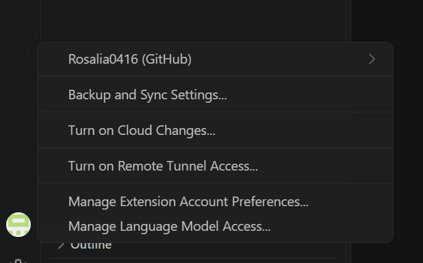

# Dev Workstation 구축 과제

## 1. 프로젝트 개요
터미널, 파일 권한, Docker, Dockerfile, 포트 매핑, 바인드 마운트, Docker 볼륨, Git/GitHub를 직접 실습하여
개발 워크스테이션을 구축하고, 수행 과정과 검증 결과를 이 문서에 기록한다.

## 2. 실행 환경
| 항목 | 내용 |
|---|---|
| OS | Microsoft Windows 11 Pro |
| 쉘 / 터미널 | Windows PowerShell major  Minor  Build  Revision
-----  -----  -----  --------
5      1      26100  9711 / VS Code 통합 터미널 |
| Docker | Docker Desktop, Docker version 29.9.3 (WSL2 기반) |
| Git | git version 2.56.0.windows.4 |
| 리눅스 실습 환경 | ubuntu 컨테이너 (Ubuntu 26.04.1 LTS) 내부 bash |

## 3. 수행 항목 체크리스트
- [x] 터미널 조작 (pwd, ls -la, cd, mkdir, cp, mv, rm, cat, touch)
- [x] 권한 실습 (파일 1개 + 디렉토리 1개, 변경 전/후)
- [x] Docker 설치 및 점검 (`docker --version`, `docker info`)
- [x] Docker 기본 운영 명령 (images, ps, ps -a, stop, logs, stats)
- [x] 컨테이너 실행 실습 (hello-world, ubuntu, attach/exec 비교)
- [x] Dockerfile 커스텀 이미지 (NGINX 베이스)
- [x] 포트 매핑 및 접속 증거 (curl + 브라우저)
- [x] 바인드 마운트 (호스트 변경 전/후)
- [x] Docker 볼륨 영속성 (컨테이너 삭제 전/후)
- [x] Git 설정 (사용자 정보, 기본 브랜치 main)
- [x] GitHub 연동 (VS Code 로그인, 원격 저장소 push)

## 4. 검증 방법 요약
| 항목 | 검증 명령 | 확인한 내용 | 결과 위치 |
|---|---|---|---|
| 터미널 조작 | `pwd`, `ls -la`, `cd`, `mkdir`, `cp`, `mv`, `rm`, `cat`, `touch` | 생성·복사·이동·이름변경·삭제 결과 | "터미널 조작 로그" 섹션 |
| 권한 | `ls -l`, `ls -ld`, `chmod`, `stat` | 파일 644→755, 디렉토리 755→700 | "권한 실습" 섹션 |
| Docker 설치 | `docker --version`, `docker info` | 버전, Server 정보 출력(데몬 동작) | "Docker 설치 및 점검" 섹션 |
| 운영 명령 | `docker images`, `ps -a`, `stop`, `logs`, `stats` | 이미지·컨테이너 상태, 로그, 리소스 | "Docker 기본 운영 명령", "커스텀 이미지" 섹션 |
| 컨테이너 실습 | `docker run`, `exec`, `attach` | hello-world, ubuntu 내부 명령, exec/attach 차이 | "컨테이너 실행 실습" 섹션 |
| Dockerfile | `docker build`, `docker run` | 커스텀 이미지 빌드, `healthy` 상태 | "Dockerfile 기반 커스텀 이미지" 섹션 |
| 포트 매핑 | `curl.exe http://localhost:8081`, 브라우저 | HTML 응답, 접속 화면 | [브라우저 스크린샷](docs/images/browser-8081.png) |
| 바인드 마운트 | `-v ${PWD}\app:...`, curl 전/후 | 재빌드 없이 1.0→2.0 반영 | [바인드 마운트 스크린샷](docs/images/bind-after.png) |
| 볼륨 | `docker volume create`, `rm -f`, 재연결 후 `cat` | 컨테이너 삭제 후에도 데이터 유지 | "Docker 볼륨 영속성 검증" 섹션 |
| Git / GitHub | `git config --list`, `git remote -v`, `git log` | 사용자·브랜치 설정, 원격 연동 | [VS Code 로그인 스크린샷](docs/images/vscode-github-login.png) |

## 5. 과제 목표 정리
- **절대 경로 vs 상대 경로**: 절대 경로는 최상위(`/`, `C:\`)부터 적는 전체 경로(`/root/practice`)이고, 상대 경로는 현재 위치 기준(`practice`, `..`)이다. 홈 폴더에서 `git init`을 실행한 실수가 "현재 위치(`.`) 기준" 동작의 대표 사례였다.
- **파일 권한 r/w/x와 755/644**: r=4, w=2, x=1을 소유자/그룹/기타 각각 더해서 표기한다. 755=`rwxr-xr-x`, 644=`rw-r--r--`.
- **커스텀 이미지**: `nginx:1.27-alpine`을 베이스로 정적 콘텐츠를 `COPY`하고 `LABEL`, `EXPOSE`, `HEALTHCHECK`를 추가했다.
- **포트 매핑이 필요한 이유**: 컨테이너는 격리된 네트워크에 있으므로 `-p 호스트:컨테이너`로 연결해야 외부(브라우저)에서 접근할 수 있다.
- **Docker 볼륨**: Docker가 관리하는 저장 공간으로, 컨테이너를 삭제해도 데이터가 남는다(영속성).
- **Git vs GitHub**: Git은 로컬에서 변경 이력을 관리하는 도구이고, GitHub는 Git 저장소를 원격으로 호스팅해 공유·협업하는 플랫폼이다.

---

# 상세 수행 기록

```bash
PS C:\Windows\system32> git --version
```
git version 2.56.0.windows.4
```
PS C:\Windows\system32> git config --global user.name "Rosalia0416"
PS C:\Windows\system32> git config --global user.email "*******@*****.com"
PS C:\Windows\system32> git confir --global init.defaultBranch main
PS C:\Windows\system32> git config --list --global
user.name=Rosalia0416## 0. 초기 Git 설정 로그

```bash
PS C:\Windows\system32> git --version
git version 2.56.0.windows.4

PS C:\Windows\system32> git config --global user.name "Rosalia0416"
PS C:\Windows\system32> git config --global user.email "*******@*****.com"
PS C:\Windows\system32> git confir --global init.defaultBranch main
git: 'confir' is not a git command. See 'git --help'.

The most similar command is
        config

PS C:\Windows\system32> git config --list
...
init.defaultbranch=master
user.name=Rosalia0416
user.email=*******@*****.com

PS C:\Windows\system32> git config --global init.defaultBranch main
PS C:\Windows\system32> git config --list --global
user.name=Rosalia0416
user.email=*******@users.noreply.github.com
init.defaultbranch=main

PS C:\Windows\system32> cd ~
## 0-2. 저장소 위치 실수 및 복구 로그 (트러블슈팅 16-2 참고)

```bash
PS C:\Users\rosakoo6480> echo "# Dev Workstation" > README.md
PS C:\Users\rosakoo6480> git init

Initialized empty Git repository in C:/Users/rosakoo6480/.git/
PS C:\Users\rosakoo6480> git add .
warning: could not open directory 'AppData/Local/Application Data/': Permission denied
warning: could not open directory 'Cookies/': Permission denied
warning: could not open directory 'Documents/My Music/': Permission denied
... (홈 폴더 전체 대상 Permission denied 경고 다수 — 개인 경로 포함으로 생략)
fatal: adding files failed

PS C:\Users\rosakoo6480> pwd
Path
----
C:\Users\rosakoo6480

PS C:\Users\rosakoo6480> Remove-Item -Recurse -Force .\.git
PS C:\Users\rosakoo6480> git status
fatal: not a git repository (or any of the parent directories): .git

PS C:\Users\rosakoo6480> mkdir dev-workstation\app, dev-workstation\docs\images -Force
PS C:\Users\rosakoo6480> cd dev-workstation
```
→ 홈 폴더에서 `git init`을 실행한 실수를 발견하고, `.git` 삭제 후 프로젝트 폴더에서 다시 시작함


    디렉터리: C:\Users\rosakoo6480\dev-workstation


Mode                 LastWriteTime         Length Name
----                 -------------         ------ ----
d-----      20216-11-11  오전 11:30                app


    디렉터리: C:\Users\rosakoo6480\dev-workstation\docs


Mode                 LastWriteTime         Length Name
----                 -------------         ------ ----
d-----      2026-11-11  오전 11:30                images


PS C:\Users\rosakoo6480> echo "# Dev Workstation" > README.md
PS C:\Users\rosakoo6480> git init
Initialized empty Git repository in C:/Users/rosakoo6480/.git/
PS C:\Users\rosakoo6480> git add .
warning: could not open directory 'AppData/Local/Application Data/': Permission denied
warning: could not open directory 'AppData/Local/History/': Permission denied
warning: could not open directory 'AppData/Local/Microsoft/Windows/INetCache/Content.IE5/': Permission denied
warning: could not open directory 'AppData/Local/Microsoft/Windows/INetCache/Low/Content.IE5/': Permission denied
warning: could not open directory 'AppData/Local/Microsoft/Windows/Temporary Internet Files/': Permission denied
warning: could not open directory 'AppData/Local/Temporary Internet Files/': Permission denied
warning: could not open directory 'AppData/Roaming/Microsoft/Windows/Start Menu/프로그램/': Permission denied
warning: could not open directory 'Application Data/': Permission denied
warning: could not open directory 'Cookies/': Permission denied
warning: could not open directory 'Documents/My Music/': Permission denied
warning: could not open directory 'Documents/My Pictures/': Permission denied
warning: could not open directory 'Documents/My Videos/': Permission denied
warning: could not open directory 'Local Settings/': Permission denied
warning: could not open directory 'My Documents/': Permission denied
warning: could not open directory 'NetHood/': Permission denied
warning: could not open directory 'PrintHood/': Permission denied
warning: could not open directory 'Recent/': Permission denied
warning: could not open directory 'SendTo/': Permission denied
warning: could not open directory 'Templates/': Permission denied
warning: could not open directory '시작 메뉴/': Permission denied
warning: in the working copy of '.copilot/logs/process-1794363562402-20952.log', LF will be replaced by CRLF the next time Git touches it
warning: in the working copy of '.copilot/logs/process-1794363562502-6740.log', LF will be replaced by CRLF the next time Git touches it
warning: in the working copy of '.gitconfig', LF will be replaced by CRLF the next time Git touches it
warning: in the working copy of '.lesshst', LF will be replaced by CRLF the next time Git touches it
warning: in the working copy of '.vscode/argv.json', LF will be replaced by CRLF the next time Git touches it
warning: in the working copy of 'AppData/Local/Claude-Data/claude_pzs8sxrjxfjjc/Extension State/CURRENT', LF will be replaced by CRLF the next time Git touches it
warning: in the working copy of 'AppData/Local/Claude-Data/claude_pzs8sxrjxfjjc/Extension State/LOG.old', LF will be replaced by CRLF the next time Git touches it
warning: in the working copy of 'AppData/Local/Claude-Data/claude_pzs8sxrjxfjjc/IndexedDB/https_claude.ai_0.indexeddb.leveldb/CURRENT', LF will be replaced by CRLF the next time Git touches it
warning: in the working copy of 'AppData/Local/Claude-Data/claude_pzs8sxrjxfjjc/IndexedDB/https_claude.ai_0.indexeddb.leveldb/LOG', LF will be replaced by CRLF the next time Git touches it
warning: in the working copy of 'AppData/Local/Claude-Data/claude_pzs8sxrjxfjjc/IndexedDB/https_claude.ai_0.indexeddb.leveldb/LOG.old', LF will be replaced by CRLF the next time Git touches it
warning: in the working copy of 'AppData/Local/Claude-Data/claude_pzs8sxrjxfjjc/Local Storage/leveldb/CURRENT', LF will be replaced by CRLF the next time Git touches it
warning: in the working copy of 'AppData/Local/Claude-Data/claude_pzs8sxrjxfjjc/Local Storage/leveldb/LOG', LF will be replaced by CRLF the next time Git touches it
warning: in the working copy of 'AppData/Local/Claude-Data/claude_pzs8sxrjxfjjc/Local Storage/leveldb/LOG.old', LF will be replaced by CRLF the next time Git touches it
error: open("AppData/Local/Claude-Data/claude_pzs8sxrjxfjjc/Network/Cookies"): Permission denied
error: unable to index file 'AppData/Local/Claude-Data/claude_pzs8sxrjxfjjc/Network/Cookies'
fatal: adding files failed
PS C:\Users\rosakoo6480> cd ~
PS C:\Users\rosakoo6480> pwd

Path
----
C:\Users\rosakoo6480


PS C:\Users\rosakoo6480> Remove-Item -Recurse -Force .\.git
PS C:\Users\rosakoo6480> git status
fatal: not a git repository (or any of the parent directories): .git
PS C:\Users\rosakoo6480> mkdir dev-workstation\app, dev-workstation\docs\images -Force


    디렉터리: C:\Users\rosakoo6480\dev-workstation


Mode                 LastWriteTime         Length Name
----                 -------------         ------ ----
d-----      2026-11-11  오전 11:30                app


    디렉터리: C:\Users\rosakoo6480\dev-workstation\docs


Mode                 LastWriteTime         Length Name
----                 -------------         ------ ----
d-----      2026-11-11  오전 11:30                images


PS C:\Users\rosakoo6480> cd dev-workstation
PS C:\Users\rosakoo6480\dev-workstation> pwd

Path
----
C:\Users\rosakoo6480\dev-workstation

```bash

PS C:\Users\rosakoo6480\dev-workstation> git init
Initialized empty Git repository in C:/Users/rosakoo6480/dev-workstation/.git/
PS C:\Users\rosakoo6480\dev-workstation> echo "# Dev Workstation" > README.md
PS C:\Users\rosakoo6480\dev-workstation> git add .
PS C:\Users\rosakoo6480\dev-workstation> git status
On branch main

No commits yet

Changes to be committed:
  (use "git rm --cached <file>..." to unstage)
        new file:   README.md

PS C:\Users\rosakoo6480\dev-workstation> git commit -m "init: 프로젝트 시작"
[main (root-commit) 291365d] init: 프로젝트 시작
 1 file changed, 0 insertions(+), 0 deletions(-)
 create mode 100644 README.md
PS C:\Users\rosakoo6480\dev-workstation> code .
PS C:\Users\rosakoo6480\dev-workstation>
```

### 6-3. 개인정보(이메일) 노출 및 히스토리 정리
- **문제:** `git config --list` 결과를 README에 붙이면서 실제 이메일이 GitHub에 공개됨
- **원인 가설:** 파일 내용뿐 아니라 이전 커밋 기록과 커밋 작성자 정보에도 이메일이 남아 있을 것
- **확인:** README 수정 후에도 이전 커밋에는 원래 내용이 남아 있음. Git은 모든 버전을 기록하기 때문
- **해결:**
  1. README의 이메일을 `****`로 마스킹
  2. 커밋 작성자 이메일을 GitHub noreply 주소로 변경
  3. orphan 브랜치로 기록을 새로 만들고 강제 push로 GitHub 기록 교체

```bash
PS> git config --global user.email "****@users.noreply.github.com"
PS> git checkout --orphan clean-main
Switched to a new branch 'clean-main'
PS> git add .
PS> git commit -m "init: 개발 워크스테이션 구축 과제"
[clean-main (root-commit) be574c6] init: 개발 워크스테이션 구축 과제
PS> git branch -D main
PS> git branch -m main
PS> git push -f origin main
 + 5d6b9c7...be574c6 main -> main (forced update)
PS> git log --oneline
be574c6 (HEAD -> main, origin/main, origin/HEAD) init: 개발 워크스테이션 구축 과제
```
- **배운 점:** Git은 로컬 버전 기록, GitHub는 원격 저장소. 한쪽만 고치면 기록이 남으므로 민감정보는 처음부터 마스킹해야 함


PS C:\Users\rosakoo6480\dev-workstation> docker run hello-world
Unable to find image 'hello-world:latest' locally
latest: Pulling from library/hello-world
4f55086f7dd0: Pull complete
d5e71e642bf5: Download complete
Digest: sha256:c567b231f65614688711a75f31518a064258a51d442117a3e771a3a8fdba78ef
Status: Downloaded newer image for hello-world:latest

Hello from Docker!
This message shows that your installation appears to be working correctly.

To generate this message, Docker took the following steps:
 1. The Docker client contacted the Docker daemon.
 2. The Docker daemon pulled the "hello-world" image from the Docker Hub.
    (amd64)
 3. The Docker daemon created a new container from that image which runs the
    executable that produces the output you are currently reading.
 4. The Docker daemon streamed that output to the Docker client, which sent it
    to your terminal.

To try something more ambitious, you can run an Ubuntu container with:
 $ docker run -it ubuntu bash

Share images, automate workflows, and more with a free Docker ID:
 https://hub.docker.com/

For more examples and ideas, visit:
 https://docs.docker.com/get-started/

PS C:\Users\rosakoo6480\dev-workstation>

## 8. Docker 기본 운영 명령

### 8-1. 이미지 / 컨테이너 목록
```bash
PS> docker images
IMAGE                ID             DISK USAGE   CONTENT SIZE   EXTRA
hello-world:latest   c567b231f656       25.9kB         9.49kB    U

PS> docker ps
CONTAINER ID   IMAGE     COMMAND   CREATED   STATUS    PORTS     NAMES

PS> docker ps -a
CONTAINER ID   IMAGE         COMMAND    CREATED         STATUS                     PORTS     NAMES
7cb22f7b13b0   hello-world   "/hello"   5 minutes ago   Exited (0) 5 minutes ago             cranky_newton
```
→ `docker ps`는 실행 중인 컨테이너만, `docker ps -a`는 종료된 컨테이너까지 표시함.
hello-world는 메시지 출력 후 바로 종료되므로 `ps -a`에만 나타남.

## 9. 컨테이너 실행 실습

### 9-1. ubuntu 컨테이너 실행 및 내부 명령
```bash
PS> docker run -it --name my-ubuntu ubuntu bash
Unable to find image 'ubuntu:latest' locally
latest: Pulling from library/ubuntu
...
Status: Downloaded newer image for ubuntu:latest
root@58c15431453b:/# echo "Hello from container"
Hello from container
root@58c15431453b:/# cat /etc/os-release
PRETTY_NAME="Ubuntu 26.04.1 LTS"
NAME="Ubuntu"
VERSION_ID="26.04"
...
root@58c15431453b:/# exit
exit

PS> docker ps -a
CONTAINER ID   IMAGE         COMMAND    CREATED          STATUS                     PORTS     NAMES
58c15431453b   ubuntu        "bash"     34 seconds ago   Exited (0) 7 seconds ago             my-ubuntu
```
→ 프롬프트가 `root@컨테이너ID:/#`로 바뀌어 컨테이너 내부에 진입했음을 확인.
`exit` 후 컨테이너도 Exited 상태가 됨 (주 프로세스인 bash가 종료되었기 때문).

### 9-2. exec로 진입 → exit (컨테이너 유지)
```bash
PS> docker start my-ubuntu
my-ubuntu
PS> docker exec -it my-ubuntu bash
root@58c15431453b:/# ls
bin  boot  dev  etc  home  lib  lib64  media  mnt  opt  proc  root  run  sbin  srv  sys  tmp  usr  var
root@58c15431453b:/# echo "exec test"
exec test
root@58c15431453b:/# exit
exit

PS> docker ps
(결과  — my-ubuntu가 Up 상태)


### 9-3. attach로 진입 → exit (컨테이너 종료)
```bash
PS> docker attach my-ubuntu
root@58c15431453b:/# exit
exit

PS> docker ps -a
CONTAINER ID   IMAGE         COMMAND    CREATED         STATUS                     PORTS     NAMES
58c15431453b   ubuntu        "bash"     2 minutes ago   Exited (0) 3 seconds ago             my-ubuntu
```

### 9-4. 컨테이너 중지
```bash
PS> docker stop my-ubuntu
my-ubuntu
PS> docker ps -a
CONTAINER ID   IMAGE         COMMAND    CREATED          STATUS                       PORTS     NAMES
58c15431453b   ubuntu        "bash"     11 minutes ago   Exited (137) 7 seconds ago             my-ubuntu
7cb22f7b13b0   hello-world   "/hello"   17 minutes ago   Exited (0) 17 minutes ago              cranky_newton
```
→ `docker stop`으로 강제 종료되어 `Exited (137)` 표시 (스스로 종료 시에는 0).

### 9-5. attach vs exec 정리
| 방식 | 동작 | exit 시 결과 |
|---|---|---|
| `docker exec -it` | 실행 중인 컨테이너에 **새 bash 프로세스를 추가** 실행 | 추가한 bash만 종료 → **컨테이너 유지 (Up)** |
| `docker attach` | 컨테이너의 **주 프로세스(PID 1, bash)**에 직접 연결 | 주 프로세스 종료 → **컨테이너 종료 (Exited)** |

- 컨테이너는 **주 프로세스가 살아 있는 동안만** 실행됨
- attach 상태에서 종료하지 않고 빠져나오려면 `Ctrl+P` → `Ctrl+Q`
- 운영 중인 컨테이너를 점검할 때는 컨테이너를 멈추지 않는 `exec`가 안전함

PS C:\Users\rosakoo6480\dev-workstation> docker start my-ubuntu
my-ubuntu
PS C:\Users\rosakoo6480\dev-workstation> docker exec -it my-ubuntu bash
root@58c15431453b:/# exit
exit

What's next:
    Try Docker Debug for seamless, persistent debugging tools in any container or image → docker debug my-ubuntu
    Learn more at https://docs.docker.com/go/debug-cli/
PS C:\Users\rosakoo6480\dev-workstation> docker ps
CONTAINER ID   IMAGE     COMMAND   CREATED          STATUS          PORTS     NAMES
58c15431453b   ubuntu    "bash"    10 minutes ago   Up 16 seconds             my-ubuntu
PS C:\Users\rosakoo6480\dev-workstation>


PS C:\Users\rosakoo6480\dev-workstation> docker ps -a
CONTAINER ID   IMAGE         COMMAND    CREATED          STATUS                       PORTS     NAMES
58c15431453b   ubuntu        "bash"     11 minutes ago   Exited (137) 7 seconds ago             my-ubuntu
7cb22f7b13b0   hello-world   "/hello"   17 minutes ago   Exited (0) 17 minutes ago              cranky_newton
PS C:\Users\rosakoo6480\dev-workstation>

58c15431453b   ubuntu    "bash"    22 minutes ago   Up 25 seconds             my-ubuntu
```
→ exec로 연 bash만 종료되어 컨테이너는 Up 상태 유지.

## 10. Dockerfile 기반 커스텀 이미지 + 포트 매핑

### 10-1. 베이스 이미지 선택
- **방식 (A)**: 웹 서버 베이스 이미지 활용 + 정적 콘텐츠 교체
- **베이스**: `nginx:1.27-alpine` (Docker Hub 공식 NGINX 이미지, alpine으로 경량화)

### 10-2. 소스 구조
```
dev-workstation/
├── Dockerfile
└── app/
    └── index.html
```

### 10-3. Dockerfile
```dockerfile
FROM nginx:1.27-alpine

LABEL maintainer="Rosalia0416" \
      description="Custom NGINX image for dev-workstation mission"

COPY app/ /usr/share/nginx/html/

EXPOSE 80

HEALTHCHECK --interval=30s --timeout=3s \
  CMD wget -q -O /dev/null http://localhost/ || exit 1
```

### 10-4. 커스텀 포인트와 목적
| 지시어 | 목적 |
|---|---|
| `FROM nginx:1.27-alpine` | 검증된 공식 웹 서버를 베이스로 사용, alpine으로 이미지 용량 절감 |
| `LABEL` | 관리자·설명 등 이미지 메타데이터 기록 |
| `COPY app/ ...` | NGINX 기본 페이지를 내 정적 콘텐츠로 교체 |
| `EXPOSE 80` | 컨테이너가 80 포트를 사용함을 명시 (문서화) |
| `HEALTHCHECK` | 30초마다 웹 응답을 점검해 컨테이너 상태를 `healthy`로 표시 |

### 10-5. 빌드
```bash
PS> docker build -t my-web:1.0 .
(#0 building with "desktop-linux" instance using docker driver

#1 [internal] load build definition from Dockerfile
#1 transferring dockerfile: 571B done
#1 DONE 0.0s

#2 [internal] load metadata for docker.io/library/nginx:1.27-alpine
#2 DONE 0.3s

#3 [internal] load .dockerignore
#3 transferring context: 2B done
#3 DONE 0.0s

#4 [internal] load build context
#4 transferring context: 59B done
#4 DONE 0.0s

#5 [1/2] FROM docker.io/library/nginx:1.27-alpine@sha256:65645c7bb6a0661892a8b03b89d0743208a18dd2f3f17a54ef4b76fb8e2f2a10
#5 resolve docker.io/library/nginx:1.27-alpine@sha256:65645c7bb6a0661892a8b03b89d0743208a18dd2f3f17a54ef4b76fb8e2f2a10 0.0s done
#5 DONE 0.0s

#6 [2/2] COPY app/ /usr/share/nginx/html/
#6 CACHED

#7 exporting to image
#7 exporting layers done
#7 exporting manifest sha256:9a1aa3353eb2b9c4602592d601ccbccd89d80675ae2b133d191d2f962cc67951 done
#7 exporting config sha256:3e1e5ecf78bb0bfc48857fab58cf348a073dec63646261ad599f19a40aba23a9 done
#7 exporting attestation manifest sha256:ce78dde97efb861b3efd63cbcf474f3bf023ab27e374a09b6eb75daa760952d0 0.0s done
#7 exporting manifest list sha256:3626ba1fa6a99c1370f79711b0324d80e9ead2ee407be1662f5d84b1055095f3 0.0s done
#7 naming to docker.io/library/my-web:1.0 done
#7 unpacking to docker.io/library/my-web:1.0 done
#7 DONE 0.1s

PS> docker images
IMAGE                ID             DISK USAGE   CONTENT SIZE   EXTRA
hello-world:latest   c567b231f656       25.9kB         9.49kB    U
my-web:1.0           52de41df12ee       73.6MB           21MB
ubuntu:latest        6a06111c3b0a        163MB         45.9MB    U
```

### 10-6. 실행 (포트 매핑)
```bash
PS> docker run -d --name my-web -p 8081:80 my-web:1.0

PS> docker ps -a
CONTAINER ID   IMAGE         COMMAND                   CREATED          STATUS                    PORTS                                     NAMES
a0af17d2fee3   my-web:1.0    "/docker-entrypoint.…"   15 minutes ago   Up 15 minutes (healthy)   0.0.0.0:8081->80/tcp, [::]:8081->80/tcp   my-web
```
- `-p 8081:80` = 호스트(내 PC) 8081 포트 → 컨테이너 80 포트로 연결
- **포트 매핑이 필요한 이유:** 컨테이너는 격리된 네트워크에서 실행되므로, 호스트 포트와 연결하지 않으면 외부(브라우저)에서 접근할 수 없음
- `(healthy)`: HEALTHCHECK 통과

### 10-7. 접속 확인
```bash
PS> curl.exe http://localhost:8081
<!DOCTYPE html>
<html lang="ko">
<head>
  <meta charset="UTF-8">
  <title>Dev Workstation</title>
  ...
<body>
  <h1>Hello from my custom NGINX container!</h1>
  <p>Dockerfile로 만든 커스텀 이미지입니다.</p>
  <p>Version: 1.0</p>
</body>
</html>
```


### 10-8. 로그 확인
```bash
PS> docker logs my-web
/docker-entrypoint.sh: Configuration complete; ready for start up
2026/11/11 06:57:07 [notice] 1#1: nginx/1.27.5
2026/11/11 06:57:07 [notice] 1#1: start worker processes
...
::1 - - [11/Nov/2026:06:57:37 +0000] "GET / HTTP/1.1" 200 420 "-" "Wget" "-"
172.17.0.1 - - [11/Nov/2026:06:57:53 +0000] "GET / HTTP/1.1" 200 420 "-" "curl/8.21.0" "-"
172.17.0.1 - - [11/Nov/2026:06:58:57 +0000] "GET / HTTP/1.1" 200 420 "-" "Mozilla/5.0 (Windows NT 10.0; Win64; x64) ... Edg/157.0.0.0" "-"
...
```
- `Wget` (30초 간격): HEALTHCHECK 자동 점검
- `curl`: 터미널 접속 / `Mozilla ... Edg`: 브라우저 접속 → 모두 `200` 성공

### 10-9. 리소스 확인
```bash
PS> docker stats --no-stream
CONTAINER ID   NAME      CPU %     MEM USAGE / LIMIT     MEM %     NET I/O           BLOCK I/O     PIDS
aad92117bf2c   my-web    0.00%     21.32MiB / 15.25GiB   0.14%     4.06kB / 3.35kB   0B / 12.3kB   25
```
→ 웹 서버 컨테이너가 메모리 약 21MiB로 가볍게 동작함을 확인


## 11. 바인드 마운트

### 11-1. 바인드 마운트로 컨테이너 실행
```bash
PS> docker run -d --name my-web-bind -p 8082:80 -v ${PWD}\app:/usr/share/nginx/html nginx:1.27-alpine
Unable to find image 'nginx:1.27-alpine' locally
1.27-alpine: Pulling from library/nginx
Status: Downloaded newer image for nginx:1.27-alpine
e65b98aaade2387db9dd363865f419305c0cf8b02256a04098f4563b68ba0a4a
```
- `-v 호스트경로:컨테이너경로` → 호스트의 `app` 폴더를 NGINX 웹 루트에 직접 연결
- `${PWD}` = 현재 폴더의 절대 경로 (`C:\Users\...\dev-workstation`)

### 11-2. 변경 전
```bash
PS> curl.exe -s http://localhost:8082 | Select-String "Version"
  <p>Version: 1.0</p>
```

### 11-3. 호스트에서 파일 수정 (VS Code)
`app/index.html`의 `Version: 1.0` → `Version: 2.0 (bind mount)`로 수정 후 저장 (재빌드 없음)

### 11-4. 변경 후 (바인드 마운트 vs 이미지 COPY 비교)
```bash
PS> curl.exe -s http://localhost:8082 | Select-String "Version"
  <p>Version: 2.0 (bind mount)</p>

PS> curl.exe -s http://localhost:8081 | Select-String "Version"
  <p>Version: 1.0</p>
```


| 컨테이너 | 방식 | 호스트 파일 수정 후 |
|---|---|---|
| my-web (8081) | Dockerfile `COPY` (이미지에 복사본 포함) | `1.0` 그대로 → 재빌드 필요 |
| my-web-bind (8082) | `-v` 바인드 마운트 (호스트 폴더 연결) | `2.0` 즉시 반영 |

→ 바인드 마운트는 개발 중 소스 수정을 바로 확인할 때 유용함

## 12. Docker 볼륨 영속성 검증

### 12-1. 볼륨 생성
```bash
PS> docker volume create my-data
my-data

PS> docker volume ls
DRIVER    VOLUME NAME
local     my-data
```

### 12-2. 볼륨 연결 및 데이터 쓰기
```bash
PS> docker run -d --name vol-test -v my-data:/data ubuntu sleep infinity
4254cec4b50b303c48c90fd9ae332fd11dac2c9ce21aa17bd18a2a5fd6c5eb86

PS> docker exec vol-test sh -c "echo 'hello volume' > /data/hello.txt"
PS> docker exec vol-test cat /data/hello.txt
hello volume
```

### 12-3. 컨테이너 삭제
```bash
PS> docker rm -f vol-test
vol-test

PS> docker ps -a
CONTAINER ID   IMAGE               COMMAND                  CREATED             STATUS                       PORTS                                     NAMES
e65b98aaade2   nginx:1.27-alpine   "/docker-entrypoint.…"   20 minutes ago      Up 20 minutes                0.0.0.0:8082->80/tcp, [::]:8082->80/tcp   my-web-bind
aad92117bf2c   b3e3cc013e8a        "/docker-entrypoint.…"   About an hour ago   Up About an hour (healthy)   0.0.0.0:8081->80/tcp, [::]:8081->80/tcp   my-web
58c15431453b   ubuntu              "bash"                   3 hours ago         Exited (137) 2 hours ago                                               my-ubuntu
7cb22f7b13b0   hello-world         "/hello"                 3 hours ago         Exited (0) 3 hours ago                                                 cranky_newton
```
→ `vol-test` 컨테이너가 완전히 삭제됨

### 12-4. 새 컨테이너에 같은 볼륨 연결 → 데이터 확인
```bash
PS> docker run -d --name vol-test2 -v my-data:/data ubuntu sleep infinity
805253f798740871d7009c06a0a7eab38a31dc5ce2b6e86816dd1a352d78bf1f

PS> docker exec vol-test2 cat /data/hello.txt
hello volume
```
→ **컨테이너를 삭제해도 볼륨의 데이터가 유지됨을 확인 (영속성)**

### 12-5. 볼륨 정보
```bash
PS> docker volume inspect my-data
[
    {
        "CreatedAt": "2026-11-11T08:04:02Z",
        "Driver": "local",
        "Labels": null,
        "Mountpoint": "/var/lib/docker/volumes/my-data/_data",
        "Name": "my-data",
        "Options": null,
        "Scope": "local"
    }
]
```

### 12-6. 정리: 컨테이너 / 바인드 마운트 / 볼륨
| 구분 | 데이터 위치 | 컨테이너 삭제 시 | 용도 |
|---|---|---|---|
| 컨테이너 내부 | 컨테이너 쓰기 레이어 | **함께 삭제** | 임시 데이터 |
| 바인드 마운트 | 호스트의 지정 경로 (`C:\...\app`) | 유지 (호스트 파일) | 개발 중 소스 실시간 반영 |
| Docker 볼륨 | Docker가 관리하는 영역 (`/var/lib/docker/volumes/...`) | **유지** | DB 등 영속 데이터 |

## 13. 터미널 조작 로그

> 실습 환경: ubuntu 컨테이너(`docker run -it --name practice ubuntu bash`) 내부의 bash

### 13-1. 현재 위치 확인 / 목록 확인 (숨김 파일 포함)
```bash
root@de3ca5cf098c:/# cd ~
root@de3ca5cf098c:~# pwd
/root
root@de3ca5cf098c:~# ls -la
total 16
drwx------ 2 root root 4096 Oct 25 10:26 .
drwxr-xr-x 1 root root 4096 Nov 11 08:11 ..
-rw-r--r-- 1 root root 3106 Apr 20  2026 .bashrc
-rw-r--r-- 1 root root  132 Apr 20  2026 .profile
```
→ `-a` 옵션으로 `.`으로 시작하는 숨김 파일(`.bashrc`, `.profile`)까지 표시

### 13-2. 디렉토리 생성 / 이동 (절대 경로 vs 상대 경로)
```bash
root@de3ca5cf098c:~# mkdir practice
root@de3ca5cf098c:~# cd /root/practice      # 절대 경로
root@de3ca5cf098c:~/practice# pwd
/root/practice
root@de3ca5cf098c:~/practice# cd ..           # 상대 경로 (상위 폴더)
root@de3ca5cf098c:~# cd practice              # 상대 경로 (현재 위치 기준)
```
| 구분 | 의미 | 예시 |
|---|---|---|
| 절대 경로 | 최상위 `/`부터 시작하는 전체 경로. 현재 위치와 무관하게 항상 같은 곳 | `/root/practice` |
| 상대 경로 | **현재 위치 기준** 경로. `.`=현재, `..`=상위 | `practice`, `..` |

### 13-3. 빈 파일 생성 / 파일 내용 확인
```bash
root@de3ca5cf098c:~/practice# touch empty.txt
root@de3ca5cf098c:~/practice# echo "hello linux" > hello.txt
root@de3ca5cf098c:~/practice# ls -la
total 12
drwxr-xr-x 2 root root 4096 Nov 11 08:12 .
drwx------ 1 root root 4096 Nov 11 08:11 ..
-rw-r--r-- 1 root root    0 Nov 11 08:12 empty.txt
-rw-r--r-- 1 root root   12 Nov 11 08:12 hello.txt

PS> docker exec practice cat /root/practice/greeting.txt
hello linux
```
→ `touch`로 만든 `empty.txt`는 크기 0 (빈 파일)

### 13-4. 복사 / 이동 / 이름 변경
```bash
root@de3ca5cf098c:~/practice# cp hello.txt hello_copy.txt
root@de3ca5cf098c:~/practice# mkdir backup
root@de3ca5cf098c:~/practice# mv hello_copy.txt backup/
root@de3ca5cf098c:~/practice# mv hello.txt greeting.txt
root@de3ca5cf098c:~/practice# ls -la
total 16
drwxr-xr-x 3 root root 4096 Nov 11 08:13 .
drwx------ 1 root root 4096 Nov 11 08:11 ..
drwxr-xr-x 2 root root 4096 Nov 11 08:13 backup
-rw-r--r-- 1 root root    0 Nov 11 08:12 empty.txt
-rw-r--r-- 1 root root   12 Nov 11 08:12 greeting.txt
root@de3ca5cf098c:~/practice# ls -la backup
total 12
drwxr-xr-x 2 root root 4096 Nov 11 08:13 .
drwxr-xr-x 3 root root 4096 Nov 11 08:13 ..
-rw-r--r-- 1 root root   12 Nov 11 08:12 hello_copy.txt
```
→ `mv`는 **다른 폴더로 옮기면 이동**, **같은 폴더에서 이름을 바꾸면 이름 변경**

### 13-5. 삭제
```bash
root@de3ca5cf098c:~/practice# rm backup/hello_copy.txt
root@de3ca5cf098c:~/practice# rmdir backup
root@de3ca5cf098c:~/practice# ls -la
total 12
drwxr-xr-x 2 root root 4096 Nov 11 08:14 .
drwx------ 1 root root 4096 Nov 11 08:11 ..
-rw-r--r-- 1 root root    0 Nov 11 08:12 empty.txt
-rw-r--r-- 1 root root   12 Nov 11 08:12 greeting.txt
```

## 14. 권한 실습

### 14-1. 변경 전
```bash
root@de3ca5cf098c:~/practice# touch perm.txt
root@de3ca5cf098c:~/practice# mkdir perm_dir
root@de3ca5cf098c:~/practice# ls -l perm.txt
-rw-r--r-- 1 root root 0 Nov 11 08:14 perm.txt
root@de3ca5cf098c:~/practice# ls -ld perm_dir
drwxr-xr-x 2 root root 4096 Nov 11 08:14 perm_dir
```

### 14-2. 권한 변경 및 변경 후
```bash
root@de3ca5cf098c:~/practice# chmod 755 perm.txt
root@de3ca5cf098c:~/practice# chmod 700 perm_dir
root@de3ca5cf098c:~/practice# ls -l perm.txt
-rwxr-xr-x 1 root root 0 Nov 11 08:14 perm.txt
root@de3ca5cf098c:~/practice# ls -ld perm_dir
drwx------ 2 root root 4096 Nov 11 08:14 perm_dir
root@de3ca5cf098c:~/practice# stat -c "%a %A %n" perm.txt perm_dir
755 -rwxr-xr-x perm.txt
700 drwx------ perm_dir
```

| 대상 | 변경 전 | 변경 후 |
|---|---|---|
| 파일 `perm.txt` | `644` `-rw-r--r--` | `755` `-rwxr-xr-x` |
| 디렉토리 `perm_dir` | `755` `drwxr-xr-x` | `700` `drwx------` |

### 14-3. 권한 해석 규칙
- 맨 앞 1글자: 종류 (`-` 파일, `d` 디렉토리)
- 나머지 9글자: **소유자(u) / 그룹(g) / 기타(o)** 각 3글자씩

| 권한 | 숫자 | 파일에서 | 디렉토리에서 |
|---|---|---|---|
| `r` (read) | 4 | 내용 읽기 | 목록 보기 (`ls`) |
| `w` (write) | 2 | 내용 수정 | 파일 생성/삭제 |
| `x` (execute) | 1 | 실행 | 안으로 들어가기 (`cd`) |

- 각 자리의 숫자를 더해서 표기: `rwx`=4+2+1=**7**, `r-x`=4+1=**5**, `rw-`=4+2=**6**, `r--`=**4**, `---`=**0**
- **755** = 소유자 `rwx`(7) / 그룹 `r-x`(5) / 기타 `r-x`(5) → 소유자만 수정, 나머지는 읽기와 실행
- **644** = 소유자 `rw-`(6) / 그룹 `r--`(4) / 기타 `r--`(4) → 소유자만 수정, 나머지는 읽기만
- **700** = 소유자만 모든 권한, 그룹과 기타는 접근 불가


## 15. GitHub 연동

### 15-1. 원격 저장소 연결 및 push
```bash
PS> git remote -v
origin  https://github.com/Rosalia0416/dev-workstation.git (fetch)
origin  https://github.com/Rosalia0416/dev-workstation.git (push)

PS> git log --oneline -5
e374df7 (HEAD -> main, origin/main, origin/HEAD) docs: 터미널 조작 및 권한 실습 기록
006cbaf docs: Docker 볼륨 영속성 검증
f43fd0c docs: 바인드 마운트 실습 기록
9b32f4e docs: 빌드 출력 추가 및 불필요 파일 삭제
3eec2a2 chore: 잘못 생성된 app/Dockerfile 삭제
```
→ 로컬 `main`과 `origin/main`이 같은 커밋을 가리켜 GitHub 반영을 확인

### 15-2. VS Code GitHub 로그인


→ VS Code 계정 메뉴에 `Rosalia0416 (GitHub)`가 표시되어 GitHub 로그인 연동을 확인

### 15-3. Git과 GitHub의 역할 차이
| 구분 | Git | GitHub |
|---|---|---|
| 정체 | 버전 관리 **프로그램** | Git 저장소를 호스팅하는 **웹 서비스** |
| 위치 | 내 컴퓨터 (로컬) | 인터넷 (원격) |
| 역할 | 변경 이력 기록 (`add`, `commit`, `log`) | 백업, 공유, 협업 (PR, Issue) |
| 연결 | `git push`로 올리고 `git pull`로 받음 | |

## 16. 트러블슈팅

### 6-1. 기본 브랜치가 master로 남음
- **문제:** `git config --list`에서 `init.defaultbranch=master`로 표시됨
- **원인 가설:** 기본 브랜치 설정 명령이 제대로 실행되지 않았을 것
- **확인:** 이전 출력에서 `git: 'confir' is not a git command` 오류 발견 (config 오타)
- **해결:** `git config --global init.defaultBranch main`을 다시 실행한 뒤 `git config --list --global`로 `init.defaultbranch=main` 확인

### 16-2. git add 시 Permission denied 대량 발생
- **문제:** `git add .` 실행 시 `Permission denied` 경고가 다수 발생하고 `fatal: adding files failed`
- **원인 가설:** Git 저장소가 의도하지 않은 위치에 생성되었을 것
- **확인:** `git init` 출력 경로가 `C:/Users/rosakoo6480/.git/`(홈 폴더 전체)였음
- **해결:** 홈 폴더의 `.git`만 삭제(`Remove-Item -Recurse -Force .\.git`) → `git status`로 저장소 해제 확인 → `dev-workstation`으로 이동해 `pwd` 확인 후 다시 `git init`
- **배운 점:** `.`은 현재 위치 기준의 **상대 경로**이므로, 명령 실행 전에 `pwd`로 위치를 확인해야 함

### 16-3. 개인정보(이메일) 노출 및 히스토리 정리
- **문제:** `git config --list` 결과를 README에 붙이면서 실제 이메일이 GitHub에 공개됨
- **원인 가설:** 파일을 고쳐도 이전 커밋 기록과 커밋 작성자 정보에 이메일이 남아 있을 것
- **확인:** README 수정 후에도 이전 커밋에서 원래 내용이 조회됨 (Git은 모든 버전을 기록)
- **해결:**
  1. README의 이메일을 `****`로 마스킹
  2. 커밋 작성자 이메일을 GitHub noreply 주소로 변경
  3. orphan 브랜치로 기록을 새로 만든 뒤 `git push -f`로 GitHub 기록 교체
```bash
PS> git config --global user.email "****@users.noreply.github.com"
PS> git checkout --orphan clean-main
PS> git add .
PS> git commit -m "init: 개발 워크스테이션 구축 과제"
PS> git branch -D main
PS> git branch -m main
PS> git push -f origin main
 + 5d6b9c7...be574c6 main -> main (forced update)
```
- **배운 점:** 민감정보는 처음부터 마스킹해야 하며, 노출 시 파일뿐 아니라 히스토리까지 정리해야 함

### 16-4. Docker 데몬 연결 실패
- **문제:** `docker info`, `docker run` 실행 시 아래 오류 발생
```bash
failed to connect to the docker API at npipe:////./pipe/dockerDesktopLinuxEngine;
check if the path is correct and if the daemon is running
```
- **원인 가설:** Docker 클라이언트는 설치되었으나 데몬(엔진)이 실행되지 않았을 것
- **확인:** `docker --version`은 성공(클라이언트 정상), `docker info`의 Server 부분에서 실패
- **해결:** Docker Desktop을 실행하고 Engine running을 확인한 뒤 다시 실행하여 정상 동작
- **배운 점:** Docker는 클라이언트(`docker` 명령)와 데몬(컨테이너를 실제로 실행하는 엔진)이 분리된 구조

### 16-5. 웹 페이지 대신 Dockerfile 내용이 표시됨
- **문제:** `localhost:8081` 접속 시 HTML 대신 Dockerfile 텍스트가 깨진 한글과 함께 표시됨
- **원인 가설:** 이미지에 복사된 `index.html` 내용이 잘못되었을 것
- **확인:** `app/index.html`을 열어 보니 Dockerfile 내용이 들어 있었음
- **해결:** HTML로 수정 → `docker build`로 **재빌드** → 컨테이너 재생성
- **배운 점:** `COPY`는 빌드 시점에 복사되므로 소스 수정 후 반드시 재빌드해야 함. 개발 중에는 바인드 마운트로 즉시 반영할 수 있음

## 17. 포트 충돌 진단 및 해결

### 17-1. 포트 충돌 재현
`my-web`이 이미 8081을 사용 중인 상태에서, 같은 호스트 포트로 새 컨테이너 실행을 시도함.
```bash
PS> docker ps
CONTAINER ID   IMAGE               COMMAND                  CREATED       STATUS                 PORTS                                     NAMES
805253f79874   ubuntu              "sleep infinity"         2 hours ago   Up 2 hours                                                       vol-test2
e65b98aaade2   nginx:1.27-alpine   "/docker-entrypoint.…"   3 hours ago   Up 3 hours             0.0.0.0:8082->80/tcp, [::]:8082->80/tcp   my-web-bind
aad92117bf2c   b3e3cc013e8a        "/docker-entrypoint.…"   3 hours ago   Up 3 hours (healthy)   0.0.0.0:8081->80/tcp, [::]:8081->80/tcp   my-web

PS> docker run -d --name port-test -p 8081:80 nginx:1.27-alpine
7d4056bb3e79e2c5bac73c612f76a71fe124dd1b595e6964d06293f4ed324f3d
docker: Error response from daemon: failed to set up container networking: driver failed programming external connectivity on endpoint port-test (...): Bind for 0.0.0.0:8081 failed: port is already allocated
```
→ 컨테이너는 생성(`Created`)되었지만, 호스트 8081 포트가 이미 사용 중이라 **시작에 실패**함

### 17-2. 진단 ① 포트를 사용 중인 프로세스(PID) 확인
```bash
PS> netstat -ano | findstr :8081
  TCP    0.0.0.0:8081           0.0.0.0:0              LISTENING       21984
  TCP    127.0.0.1:8081         0.0.0.0:0              LISTENING       14976
  TCP    [::]:8081              [::]:0                 LISTENING       21984
  TCP    [::1]:8081             [::]:0                 LISTENING       14976

PS> Get-NetTCPConnection -LocalPort 8081 -State Listen | Select-Object LocalAddress, LocalPort, State, OwningProcess

LocalAddress LocalPort  State OwningProcess
------------ ---------  ----- -------------
::1               8081 Listen         14976
::                8081 Listen         21984
127.0.0.1         8081 Listen         14976
```
- `netstat -ano`: 모든 연결(`-a`)을 숫자 주소(`-n`)와 PID(`-o`)로 표시
- `LISTENING` 상태의 맨 끝 숫자가 포트를 점유한 **PID**

### 17-3. 진단 ② PID → 프로그램 이름 확인
```bash
PS> Get-Process -Id 21984, 14976

Handles  NPM(K)    PM(K)      WS(K)     CPU(s)     Id  SI ProcessName
-------  ------    -----      -----     ------     --  -- -----------
   1080      55   185124     193312     128.77  21984   1 com.docker.backend
    222      17     3080      11792       0.09  14976   1 wslrelay
```
- `com.docker.backend`: Docker Desktop 본체 (포트 매핑 처리)
- `wslrelay`: WSL2 ↔ Windows localhost 연결 중계
→ 포트를 점유한 것은 **Docker**임을 확인

### 17-4. 진단 ③ 포트를 사용 중인 컨테이너 확인
```bash
PS> docker ps --filter "publish=8081"
CONTAINER ID   IMAGE          COMMAND                  CREATED       STATUS                 PORTS                                     NAMES
aad92117bf2c   b3e3cc013e8a   "/docker-entrypoint.…"   3 hours ago   Up 3 hours (healthy)   0.0.0.0:8081->80/tcp, [::]:8081->80/tcp   my-web
```
→ 원인: **`my-web` 컨테이너가 8081 사용 중**

### 17-5. 해결 방법 A — 다른 호스트 포트로 변경
```bash
PS> docker ps -a --filter "name=port-test"
CONTAINER ID   IMAGE               COMMAND                  CREATED         STATUS    PORTS     NAMES
7d4056bb3e79   nginx:1.27-alpine   "/docker-entrypoint.…"   2 minutes ago   Created             port-test

PS> docker rm port-test
port-test

PS> docker run -d --name port-test -p 8083:80 nginx:1.27-alpine
c4ed76dc6321f9a4854670d8d9e2437dce5541f16364ff5ace8968d2bab367e1

PS> curl.exe -I http://localhost:8083
HTTP/1.1 200 OK
Server: nginx/1.27.5
Content-Type: text/html
Content-Length: 615
```
→ 실패로 남은 `Created` 컨테이너를 삭제한 뒤, 비어 있는 **8083**으로 실행하여 성공

### 17-6. 해결 방법 B — 포트를 점유한 쪽을 중지해 포트 해제
```bash
PS> docker stop my-web
my-web

PS> netstat -ano | findstr :8081
  TCP    127.0.0.1:61462        127.0.0.1:8081         TIME_WAIT       0

PS> docker rm -f port-test
port-test

PS> docker run -d --name port-test -p 8081:80 nginx:1.27-alpine
7b7f61c19bd21ff3205944ece18f99fdf893d9d5658cdf008055a92849c85dc2

PS> curl.exe -I http://localhost:8081
HTTP/1.1 200 OK
Server: nginx/1.27.5
Content-Type: text/html
Content-Length: 615
```
- `my-web` 중지 후 `LISTENING` 줄이 사라져 8081이 **해제**됨
- 남은 `TIME_WAIT` 줄은 직전 curl 연결이 닫히며 잠시 남은 흔적(PID 0)으로, 포트를 점유하지 않음
→ 해제된 8081로 새 컨테이너 실행 성공

### 17-7. 원상 복구
```bash
PS> docker rm -f port-test
port-test

PS> docker start my-web
my-web

PS> docker ps
CONTAINER ID   IMAGE               COMMAND                  CREATED       STATUS                            PORTS                                     NAMES
805253f79874   ubuntu              "sleep infinity"         2 hours ago   Up 2 hours                                                                  vol-test2
e65b98aaade2   nginx:1.27-alpine   "/docker-entrypoint.…"   3 hours ago   Up 3 hours                        0.0.0.0:8082->80/tcp, [::]:8082->80/tcp   my-web-bind
aad92117bf2c   b3e3cc013e8a        "/docker-entrypoint.…"   3 hours ago   Up 5 seconds (health: starting)   0.0.0.0:8081->80/tcp, [::]:8081->80/tcp   my-web
```

### 17-8. 포트 충돌 대응 절차 요약
| 단계 | 명령 (Windows PowerShell) | 목적 |
|---|---|---|
| 1. 증상 확인 | `docker run ... -p 8081:80` → `port is already allocated` | 충돌 발생 확인 |
| 2. PID 찾기 | `netstat -ano \| findstr :8081` 또는 `Get-NetTCPConnection -LocalPort 8081` | 포트 점유 프로세스 번호 |
| 3. 프로그램 확인 | `Get-Process -Id <PID>` | 어떤 프로그램인지 식별 |
| 4. 컨테이너 확인 | `docker ps --filter "publish=8081"` | Docker라면 어느 컨테이너인지 |
| 5-A. 포트 변경 | `docker run -p 8083:80 ...` | 다른 빈 포트 사용 |
| 5-B. 포트 해제 | `docker stop <컨테이너>` | 점유 중인 컨테이너 중지 |
| 5-C. 포트 해제 (Docker 외 프로그램) | `Stop-Process -Id <PID>` | 다른 프로그램이 점유한 경우 종료 (**Docker 프로세스에는 사용 금지**) |

> 참고 (Linux/macOS): `sudo lsof -i :8081` 또는 `sudo ss -lntp | grep 8081`로 PID 확인 → `kill <PID>`로 종료